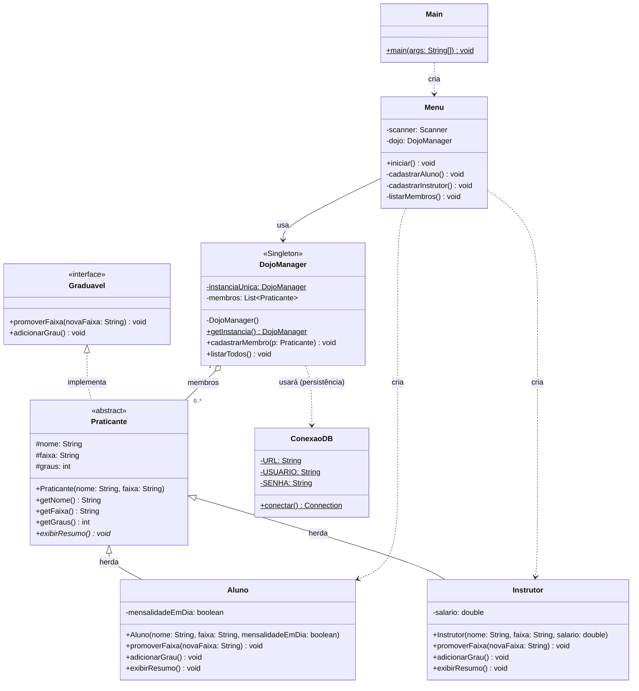

# DojôSys | Diagrama de Classes UML (v1)

Responsável: João Gabriel

Esta é a primeira versão do diagrama. Ela mostra as classes que já estão na branch `main`, mais o `Menu` e o `Main`. O GitHub desenha o diagrama automaticamente a partir do bloco abaixo (sintaxe Mermaid).

## Conceitos de POO no diagrama

| Conceito | Onde aparece |
|---|---|
| Herança | `Aluno` e `Instrutor` herdam de `Praticante` |
| Classe abstrata | `Praticante` (não pode ser instanciada; `exibirResumo()` é abstrato) |
| Interface | `Graduavel`, implementada por `Praticante` |
| Polimorfismo | `DojoManager.listarTodos()` chama `exibirResumo()` e cada subclasse responde do seu jeito |
| Encapsulamento | atributos `private`/`protected` com acesso por getters |
| Singleton | `DojoManager` (construtor privado + `getInstancia()`) |

## Legenda

- `+` público, `-` privado, `#` protegido
- `$` membro estático, `*` método abstrato
- Seta com triângulo cheio: herança. Seta tracejada com triângulo: implementação de interface
- Losango vazio: agregação (o dojô tem praticantes)
- Seta tracejada simples: dependência (uma classe usa ou cria a outra)

## Próximas versões (planejado)

Itens que ainda não existem no código e entram no diagrama quando forem implementados:

- Datas de graduação em `Praticante` (ex.: `dataUltimaPromocao`), para validar o tempo mínimo em cada faixa
- Regras de promoção (ordem das faixas, máximo de 4 graus, tempo mínimo) dentro de `promoverFaixa()`
- Busca de praticantes no `DojoManager` (ex.: `buscarPorNome()`), para o menu poder promover e dar grau
- Classe ou registros de mensalidade (valor, vencimento, status de pagamento)
- Classes de acesso ao banco (ex.: `PraticanteDAO`) usando `ConexaoDB`
