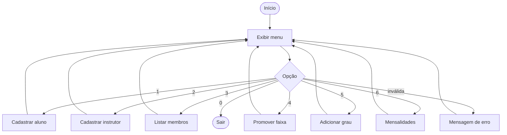
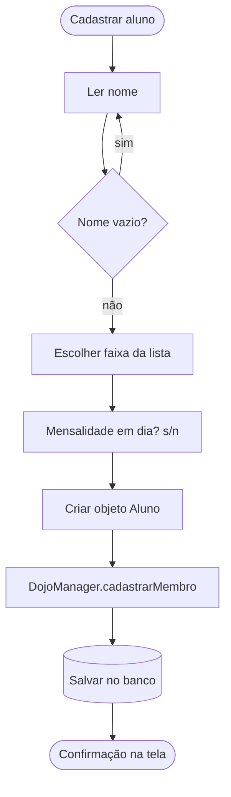
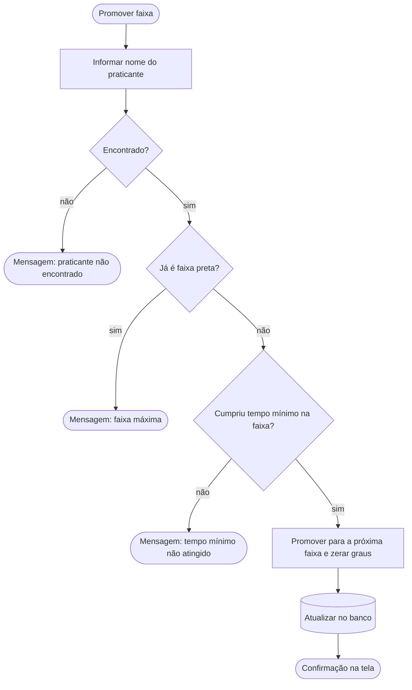
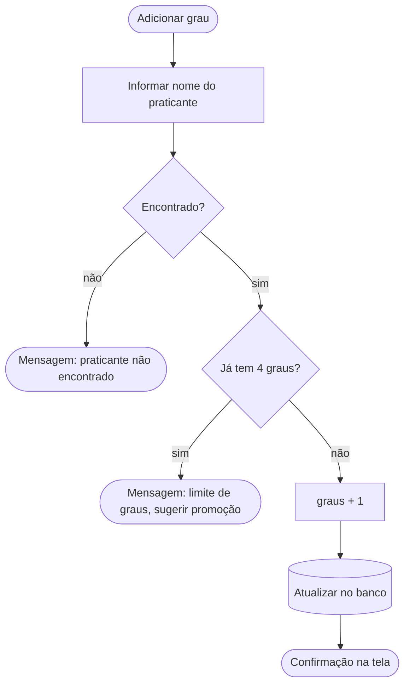

# DojôSys | Escopo e Fluxos do Sistema

Responsável: João Gabriel

## 1. Objetivo

Sistema de console em Java para a gestão de um dojô de Jiu-Jitsu: cadastro de alunos e instrutores, controle de mensalidades e acompanhamento de graduações (faixas e graus), com persistência em PostgreSQL via JDBC.

## 2. Escopo

### Dentro do escopo

1. **Cadastro de praticantes**: alunos e instrutores, com nome, faixa e graus.
2. **Listagem**: exibir todos os membros com um resumo de cada um.
3. **Graduação**:
   - adicionar grau (de 0 a 4 por faixa);
   - promover de faixa, respeitando a ordem das faixas e o tempo mínimo em cada uma.
4. **Mensalidades**: registrar se o aluno está com a mensalidade em dia ou atrasada e listar os inadimplentes.
5. **Persistência**: salvar e carregar praticantes do banco PostgreSQL.
6. **Testes unitários** com `assert`.

### Fora do escopo

- Interface gráfica ou web (o sistema é de console).
- Login e controle de usuários.
- Emissão de boletos ou integração com meios de pagamento.
- Controle de presença em aulas e grade de horários.

## 3. Regras de negócio

| Código | Regra |
|---|---|
| RN01 | Ordem das faixas (adulto): Branca → Azul → Roxa → Marrom → Preta |
| RN02 | Cada faixa tem no máximo 4 graus; ao ser promovido, o praticante volta para 0 graus |
| RN03 | Só pode ser promovido para a faixa seguinte (não pula faixas nem volta) |
| RN04 | Tempo mínimo na faixa antes de promover. Sugestão baseada na IBJJF: Azul 2 anos, Roxa 1 ano e meio, Marrom 1 ano. **A equipe precisa confirmar esses valores.** |
| RN05 | Aluno com mensalidade atrasada aparece com status "Atrasada" na listagem |
| RN06 | Nome e faixa são obrigatórios no cadastro |
| RN07 | Instrutor deve ter faixa preta (a confirmar com a equipe) |

## 4. Fluxos de funcionamento

### 4.1 Menu principal

### 4.2 Cadastro de aluno

### 4.3 Promoção de faixa

### 4.4 Adicionar grau

## 5. Status atual do menu

| Opção | Status |
|---|---|
| 1 - Cadastrar aluno | Funcionando (em memória) |
| 2 - Cadastrar instrutor | Funcionando (em memória) |
| 3 - Listar membros | Funcionando |
| 4 - Promover faixa | Aguardando busca de praticante no `DojoManager` |
| 5 - Adicionar grau | Aguardando busca de praticante no `DojoManager` |
| 6 - Mensalidades | Aguardando regras de mensalidade |
